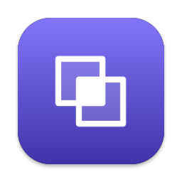

# Tandem

A macOS menu-bar app that keeps windows together. Put two to six windows side by side, tile
them, and they resize, switch and go full screen as one.



Written in Rust, with no dependencies beyond bindings to macOS. What was interesting about it:

- **Control without ownership.** Other apps own their windows, and can be slow, refuse or hang.
  Each window gets a thread that skips to the newest target, reads back, and retries.
- **No macOS API for half of it.** Picks in Mission Control, stacking across apps and real
  minimum sizes are worked out from what can be observed.
- **Decisions kept pure.** Layout, gestures and timing take their inputs as arguments, the
  clock included, so they are tested without a window in sight.

## Build and run

```sh
./bundle.sh install     # builds it, puts it in /Applications and opens it
```

Allow it in System Settings > Privacy & Security > Accessibility, then quit and reopen it.
Rebuilding keeps the permission.

## Use

| To | Do |
|---|---|
| Make a group | Arrange windows, then menu > **Tile** or ⌃⌥T |
| Resize | Drag the bar between two windows; double-click evens them |
| Swap | Drag a tile by its title bar onto another |
| Add | Hold Shift while dragging a window onto half of a tile |
| Change the layout | Hover the group in the menu, or ⌃⌥L |
| Switch | Click any window of the group, Cmd-Tab, Mission Control, or the menu |
| See groups in Mission Control | Menu > **Settings** > **Show Groups in Mission Control** |
| Change corners | Menu > **Settings** > **Window Corners**, then reopen apps |
| Everything else | The group's submenu |

A small window over a group stays with it, as in plain macOS. A large one counts as separate.

## Develop

```sh
cargo test                  # pure logic, no windows involved
cargo clippy --all-targets
tail -f ~/Library/Logs/tandem.log
```

- [docs/ARCHITECTURE.md](docs/ARCHITECTURE.md): how it fits together
- [docs/QUIRKS.md](docs/QUIRKS.md): macOS behaviour that shaped the code
- [docs/READING.md](docs/READING.md): the systems ideas in it, and how to study them

## Limits

- Main display only.
- macOS cannot merge windows in Mission Control, so groups can get a bar there instead.
- Full screen stays below the menu bar, and hides the Dock for everything. After a crash
  the Dock comes back at the next start, or with `/Applications/Tandem.app/Contents/MacOS/tandem --restore`
- Uses a few private macOS calls that an update could break.

The icon is from [Phosphor](https://phosphoricons.com), MIT-licensed.
